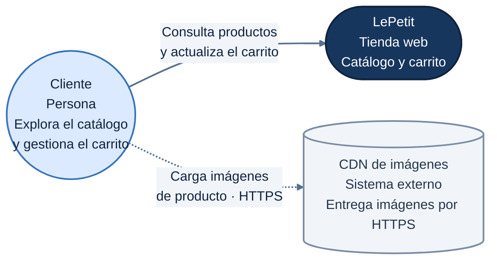
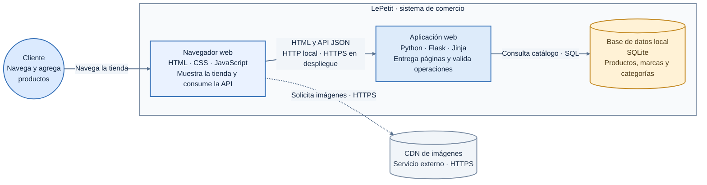
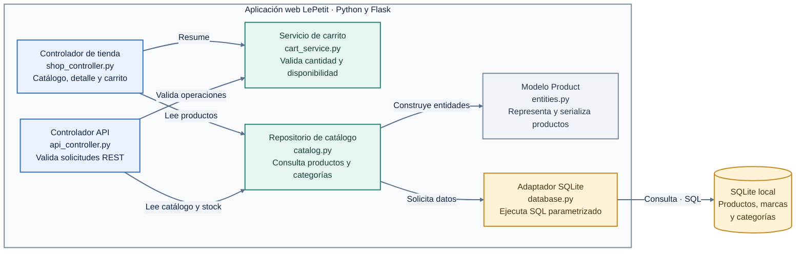
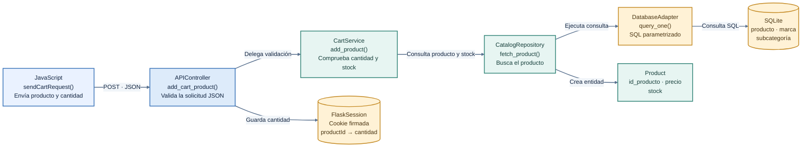

# Modelo C4 de LePetit

Los diagramas muestran el mismo sistema mediante cuatro niveles de zoom. Se utiliza Mermaid estándar para que los gráficos se rendericen en GitHub y en otros visores Mermaid. La paleta azul, verde y ámbar, el texto oscuro y las etiquetas concisas ayudan a mantener el contraste y el espacio entre elementos. Las fuentes editables están en [docs/diagramas](diagramas/).

1. **C1 — Contexto:** quién usa LePetit y con qué servicio externo se comunica.
2. **C2 — Contenedores:** navegador, aplicación Flask, base de datos y CDN.
3. **C3 — Componentes:** estructura interna del backend Flask.
4. **C4 — Código:** módulos y clases que participan al agregar un producto al carrito.

## C1 — Contexto

Fuente editable: [C1-contexto.mmd](diagramas/C1-contexto.mmd).

El cliente consulta el catálogo y mantiene un carrito temporal. El CDN sirve las imágenes de muestra. No hay pasarela de pagos, correo, mapas ni proveedor de autenticación; el checkout queda fuera del alcance.

## C2 — Contenedores

Fuente editable: [C2-contenedores.mmd](diagramas/C2-contenedores.mmd).

El navegador recibe páginas HTML renderizadas por Flask y consume la API JSON del mismo origen. Flask accede al catálogo en SQLite mediante SQL parametrizado. Las imágenes se solicitan al CDN por HTTPS. En desarrollo local, la aplicación usa HTTP.

## C3 — Componentes

Fuente editable: [C3-componentes.mmd](diagramas/C3-componentes.mmd).

`shop_controller.py` entrega las vistas; `api_controller.py` publica el contrato HTTP; `cart_service.py` valida las reglas del carrito; `catalog.py` consulta datos; `entities.py` contiene el modelo de producto; `database.py` administra la conexión SQLite.

## C4 — Código: agregar producto al carrito

Fuente editable: [C4-funcionalidad-carrito.mmd](diagramas/C4-funcionalidad-carrito.mmd).

1. JavaScript envía `POST /api/v1/carrito/productos` con `{"product_id":"LAP-B0BS4BP8FB","quantity":1}`.
2. `add_cart_product` valida el JSON y delega a `cart_service.add_product`.
3. El servicio consulta el producto y su stock con `catalog.fetch_product`; el repositorio ejecuta SQL parametrizado mediante `database.query_one`.
4. Si el producto existe y hay stock, Flask guarda identificador y cantidad en la cookie firmada de sesión y responde `201`. Si el producto no existe responde `404`, si los datos son inválidos `400` y si no hay stock suficiente `409`.
5. El navegador actualiza el contador y muestra el resultado. El carrito es temporal: no crea una orden ni descuenta inventario.

Al cargar la interfaz, `static/js/app.js` consulta `GET /api/v1/salud`; Flask ejecuta `SELECT 1` en SQLite y la vista muestra el estado. El navegador nunca abre una conexión SQL directamente.

## Coherencia entre niveles

- El cliente y LePetit de C1 se amplían a navegador, aplicación Flask y SQLite en C2.
- Los componentes de C3 viven dentro de la aplicación Flask de C2.
- El flujo del carrito en C4 implementa los componentes de API, carrito, catálogo, producto, adaptador y sesión.
- El precio y stock se consultan en SQLite; la sesión almacena temporalmente solo identificadores y cantidades.
- El precio se guarda como USD base y se convierte a COP mediante `USD_TO_COP_RATE`.

El modelo de datos está en [modelo-entidad-relacion.mmd](diagramas/modelo-entidad-relacion.mmd).
