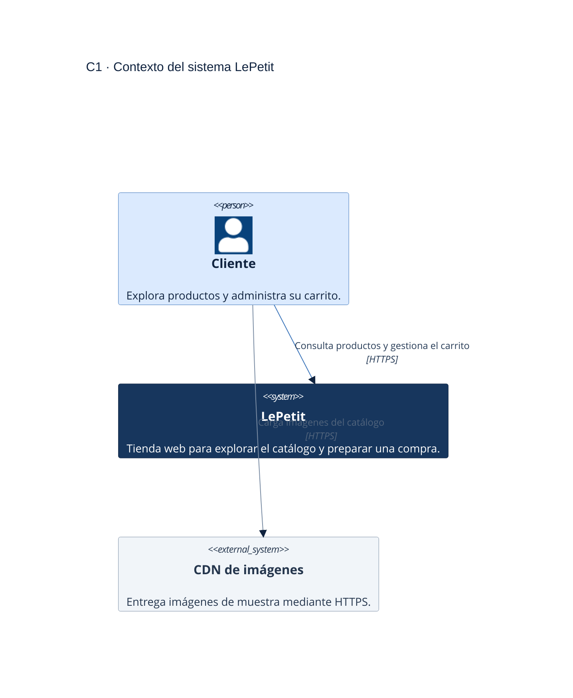
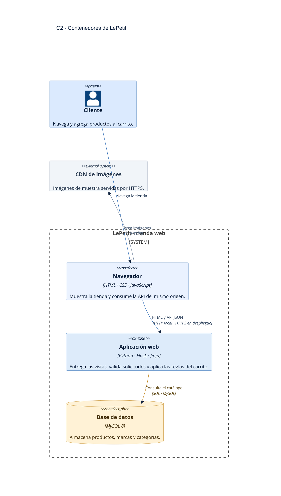
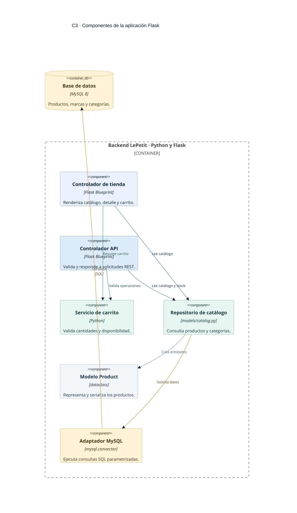

# Modelo C4 de LePetit

El modelo mantiene el zoom progresivo entre los niveles y utiliza una paleta clara de azul, verde y ámbar. Los nodos tienen texto oscuro de alto contraste, títulos breves y responsabilidades resumidas para evitar cruces y etiquetas encimadas. Los archivos Mermaid son la fuente editable de cada diagrama.

1. **C1 — Contexto:** quién usa LePetit y con qué sistema externo se comunica.
2. **C2 — Contenedores:** navegador, aplicación Flask y base de datos MySQL.
3. **C3 — Componentes:** responsabilidades internas de la aplicación Flask.
4. **C4 — Código:** clases y módulos que colaboran al agregar un producto al carrito.

## C1 — Contexto



Fuente editable: [C1-contexto.mmd](diagramas/C1-contexto.mmd).

El navegador del cliente obtiene las imágenes de demostración desde un CDN. No hay pasarela de pagos, correo, mapas ni proveedor de autenticación conectado; el checkout queda fuera del alcance.

## C2 — Contenedores



Fuente editable: [C2-contenedores.mmd](diagramas/C2-contenedores.mmd).

El navegador recibe HTML renderizado por Flask y consume la API JSON del mismo origen. Flask consulta MySQL mediante SQL. HTTPS se usa en despliegue o cuando se configuran certificados locales; el desarrollo simple utiliza HTTP.

## C3 — Componentes



Fuente editable: [C3-componentes.mmd](diagramas/C3-componentes.mmd).

`shop_controller.py` entrega las vistas; `api_controller.py` publica el contrato HTTP; `cart_service.py` concentra las reglas del carrito; `catalog.py` consulta los datos; `entities.py` contiene el modelo de producto; `database.py` administra la conexión MySQL.

## C4 — Código: agregar producto al carrito

```mermaid
%%{init: {"theme":"base","themeVariables":{"fontFamily":"Aptos, Segoe UI, Arial, sans-serif","fontSize":"16px","primaryColor":"#EAF2FF","primaryTextColor":"#10233F","primaryBorderColor":"#3973B9","lineColor":"#58708E","secondaryColor":"#F1F5F9","tertiaryColor":"#E7F5F2","background":"#FFFFFF","mainBkg":"#FFFFFF","textColor":"#10233F","classText":"#10233F"}}}%%
classDiagram
    direction TB

    class BrowserJavaScript {
        +sendCartRequest(url, method, body)
        +updateCartCount(count)
        +showFeedback(message)
    }
    class APIController {
        +add_cart_product()
        +change_cart_product(productId)
        +delete_cart_product(productId)
    }
    class CartService {
        +add_product(cart, productId, quantity)
        +update_quantity(cart, productId, quantity)
        +cart_summary(cart)
    }
    class CatalogRepository {
        +fetch_product(productId)
        +fetch_products_by_ids(productIds)
    }
    class Product {
        +id_producto: str
        +precio: Decimal
        +stock: int
        +to_dict(rate)
    }
    class DatabaseAdapter {
        +query_one(sql, params)
        +query_all(sql, params)
    }
    class FlaskSession {
        <<cookie firmada>>
        cart: productId to quantity
    }
    class MySQL {
        <<base de datos>>
        producto
        marca
        subcategoria
        categoria_principal
    }

    BrowserJavaScript --> APIController : POST JSON · HTTP
    APIController --> CartService : valida operación
    APIController --> FlaskSession : guarda cantidades
    CartService --> CatalogRepository : verifica producto y stock
    CatalogRepository --> Product : crea entidad
    CatalogRepository --> DatabaseAdapter : SQL parametrizado
    DatabaseAdapter --> MySQL : consulta de producto

    classDef frontend fill:#EAF2FF,stroke:#3973B9,color:#10233F,stroke-width:2px;
    classDef controller fill:#DDEBFA,stroke:#3973B9,color:#10233F,stroke-width:2px;
    classDef service fill:#E7F5F2,stroke:#318477,color:#153E3A,stroke-width:2px;
    classDef data fill:#FFF2D6,stroke:#C48A24,color:#4A3512,stroke-width:2px;
    class BrowserJavaScript frontend;
    class APIController controller;
    class CartService service;
    class CatalogRepository,Product service;
    class DatabaseAdapter,MySQL data;
    class FlaskSession frontend;
```

Fuente editable: [C4-funcionalidad-carrito.mmd](diagramas/C4-funcionalidad-carrito.mmd).

1. JavaScript envía `POST /api/v1/carrito/productos` con `{"product_id":"LP-001","quantity":1}`.
2. `add_cart_product` valida el JSON y delega a `cart_service.add_product`.
3. El servicio solicita el producto y su stock con `catalog.fetch_product`; el repositorio ejecuta SQL parametrizado mediante `database.query_one`.
4. Si el producto existe y la cantidad no supera el stock, Flask guarda el carrito en la sesión firmada y responde `201`. Si el producto no existe responde `404`, si los datos son inválidos `400` y si no hay stock suficiente `409`.
5. El navegador actualiza el contador y anuncia el resultado. El carrito es temporal; no crea una orden ni descuenta inventario.

Al cargar la interfaz, `static/js/app.js` consulta `GET /api/v1/salud`; Flask ejecuta `SELECT 1` en MySQL y la vista muestra el estado. El navegador nunca abre una conexión SQL directamente.

## Coherencia y alcance

- El navegador, Flask y MySQL de C2 pertenecen al sistema LePetit de C1.
- Los componentes de C3 están contenidos en el backend Flask de C2.
- La funcionalidad de C4 utiliza los componentes de API, carrito, catálogo, producto, adaptador y sesión.
- La sesión almacena identificadores y cantidades; los datos descriptivos, el precio y el stock se vuelven a leer desde MySQL.
- El precio se guarda como USD base y se convierte a COP mediante `USD_TO_COP_RATE`.

Fuentes Mermaid editables: [C1](diagramas/C1-contexto.mmd), [C2](diagramas/C2-contenedores.mmd), [C3](diagramas/C3-componentes.mmd) y [C4](diagramas/C4-funcionalidad-carrito.mmd). El modelo de datos está en [modelo-entidad-relacion.mmd](diagramas/modelo-entidad-relacion.mmd).
