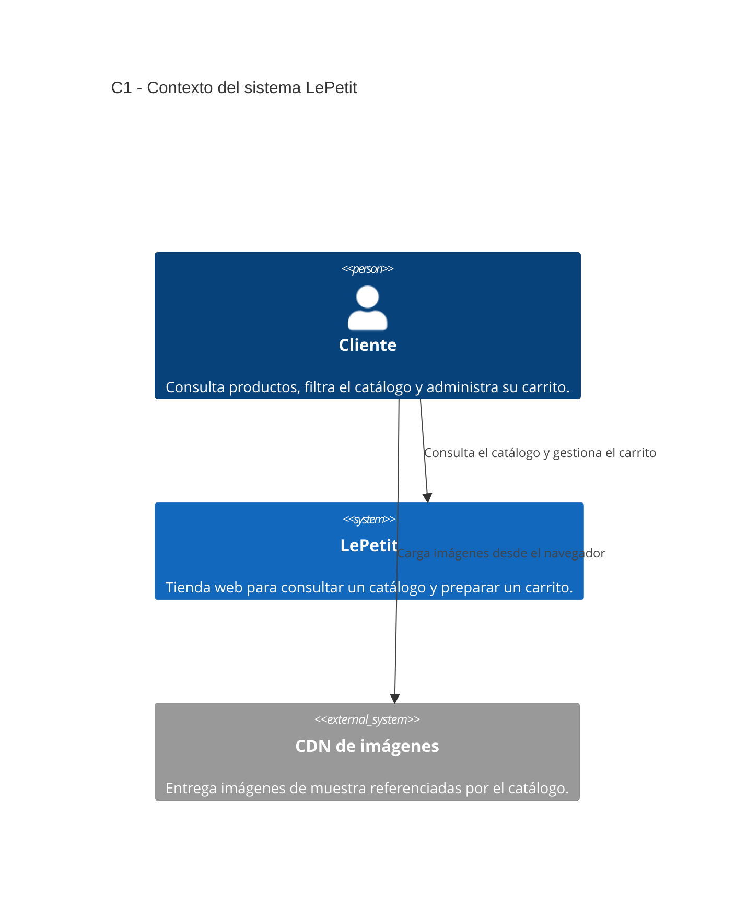
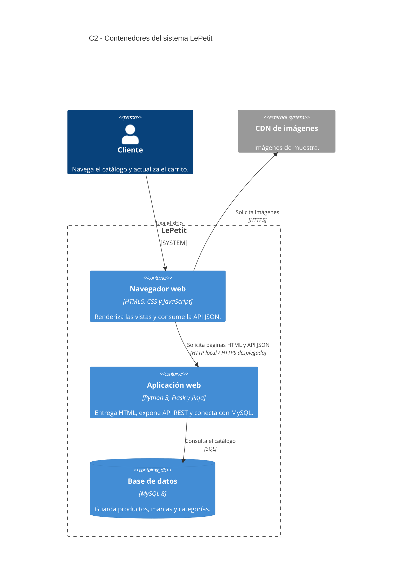
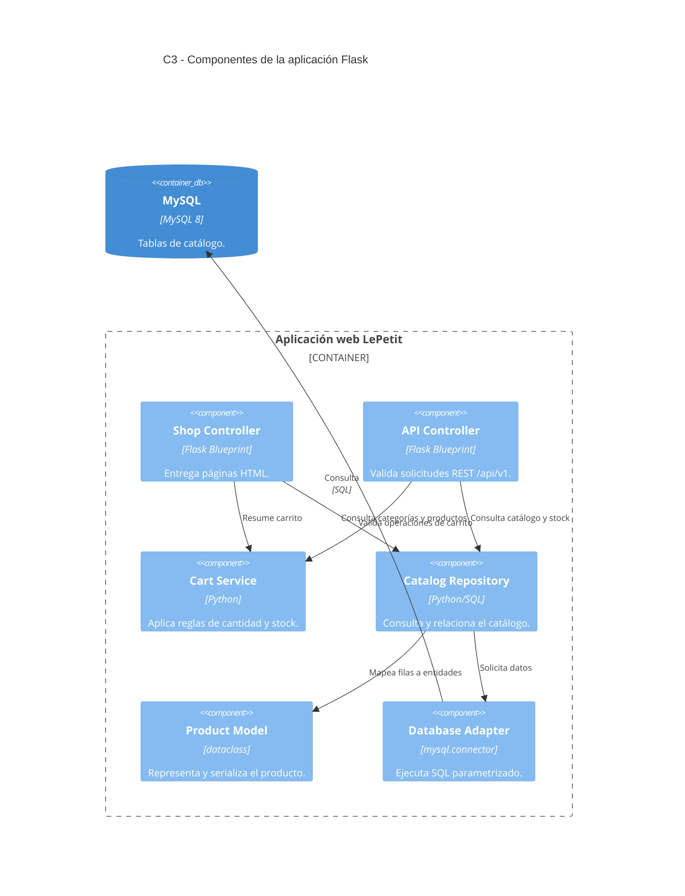
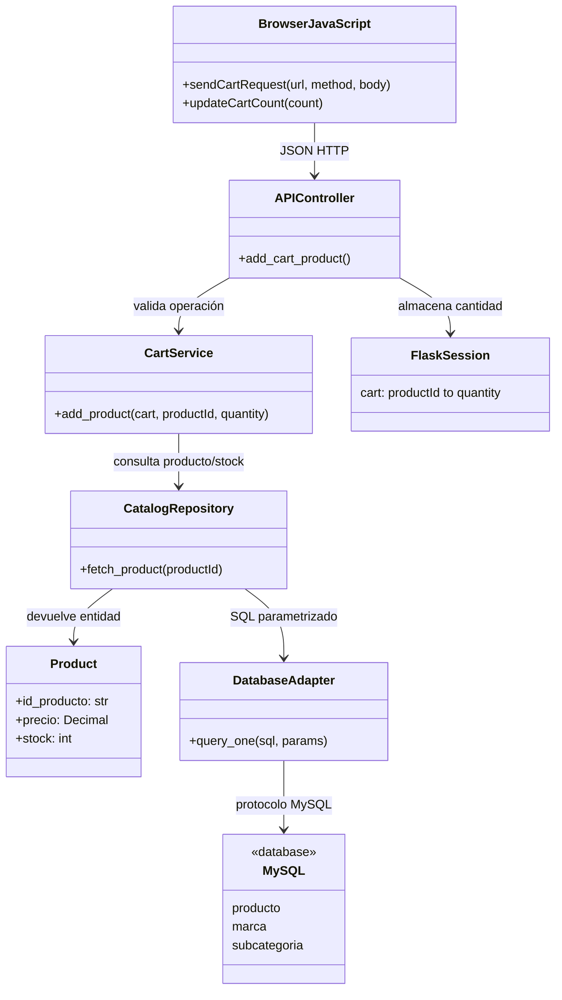

# Modelo C4 de LePetit

El zoom mantiene la misma frontera en cada nivel:

1. C1 presenta al cliente, el sistema y la entrega externa de imágenes de muestra.
2. C2 descompone LePetit en navegador, aplicación Flask y base MySQL.
3. C3 amplía el backend Flask en controladores, servicio, repositorio, modelo y adaptador de base de datos.
4. C4 muestra el código del flujo de agregar un producto al carrito, incluyendo validación de stock, sesión y persistencia de catálogo.

## C1 — Contexto

Fuente Mermaid editable: [C1-contexto.mmd](diagramas/C1-contexto.mmd).

El cliente usa la tienda. El navegador también obtiene las imágenes de muestra de un CDN externo. No hay pasarela de pagos, correo, mapas ni proveedor de autenticación conectado en esta versión; el checkout queda fuera del alcance.

## C2 — Contenedores

Fuente Mermaid editable: [C2-contenedores.mmd](diagramas/C2-contenedores.mmd).

El navegador obtiene HTML renderizado por Flask y solicita la API JSON en el mismo origen. Flask consulta MySQL mediante SQL. HTTPS se usa en despliegue o al configurar certificados locales; la ejecución local simple utiliza HTTP.

## C3 — Componentes

Fuente Mermaid editable: [C3-componentes.mmd](diagramas/C3-componentes.mmd).

`shop_controller.py` entrega las vistas; `api_controller.py` publica el contrato HTTP; `cart_service.py` concentra las reglas del carrito; `catalog.py` es el repositorio; `entities.py` contiene el modelo de producto; `database.py` administra la conexión MySQL.

## C4 — Código: agregar producto al carrito

Fuente Mermaid editable: [C4-funcionalidad-carrito.mmd](diagramas/C4-funcionalidad-carrito.mmd).

1. JavaScript envía `POST /api/v1/carrito/productos` con `{"product_id":"LP-001","quantity":1}`.
2. `add_cart_product` valida JSON y delega a `cart_service.add_product`.
3. El servicio consulta el producto y el stock por `catalog.fetch_product`; el repositorio usa SQL parametrizado a través de `database.query_one`.
4. Si el producto existe y la cantidad no supera el stock, se actualiza el carrito en la sesión Flask firmada y se responde `201` con JSON. Si no existe se responde `404`; cantidad inválida, `400`; stock insuficiente, `409`.
5. El navegador actualiza el contador y anuncia el resultado. El carrito es temporal y no crea una orden ni descuenta inventario.

Al cargar la interfaz, `static/js/app.js` consulta `GET /api/v1/salud`; Flask ejecuta `SELECT 1` por la conexión MySQL y la vista muestra el estado. JavaScript no realiza conexiones SQL desde el navegador.

## Coherencia y alcance

- La API y la interfaz son parte del sistema LePetit mostrado en C1.
- El navegador, Flask y MySQL de C2 corresponden a los componentes mostrados en C3.
- El endpoint del carrito implementa la funcionalidad C4 a través de `APIController`, `CartService`, `CatalogRepository`, `Product` y `DatabaseAdapter`.
- La sesión almacena temporalmente los identificadores y cantidades; los datos descriptivos y el precio se vuelven a leer desde MySQL para no confiar en valores enviados por el cliente.
- El precio almacenado en la base se interpreta como USD base y la aplicación lo transforma a COP mediante la tasa configurable `USD_TO_COP_RATE`.

Fuentes Mermaid editables: [C1](diagramas/C1-contexto.mmd), [C2](diagramas/C2-contenedores.mmd), [C3](diagramas/C3-componentes.mmd), [C4](diagramas/C4-funcionalidad-carrito.mmd). El modelo de datos está en [modelo-entidad-relacion.mmd](diagramas/modelo-entidad-relacion.mmd).